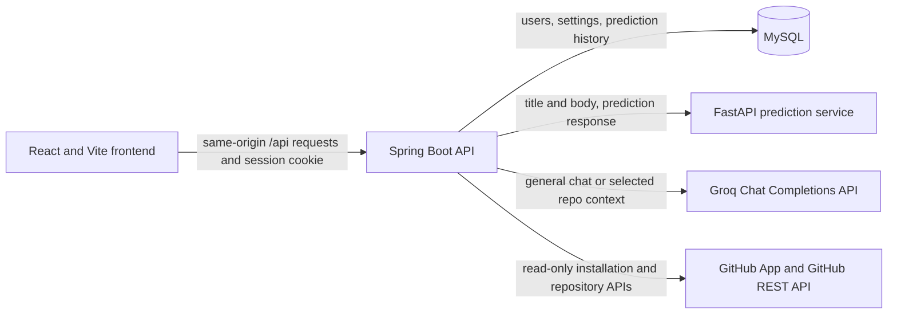

# DevPilot AI architecture

## Request and data boundaries

- The frontend is a React JavaScript single-page application. It sends API
  requests to the Spring Boot backend using the browser session.
- Spring Boot owns authentication, account-scoped settings, prediction history,
  chat routing, and the GitHub App integration. MySQL is the application store.
- The Python FastAPI service loads the paired TF-IDF vectorizer and Logistic
  Regression artifact and returns a label plus per-class probabilities. It is
  intended to be reachable only by the backend or on a private network.
- General chat is sent to Groq without GitHub context. Repository questions can
  inspect only repositories the user has explicitly enabled. Repository tools
  are read-only; short-lived installation tokens are created by the backend.
  Retrieved source is untrusted input and is sent to Groq only when needed.
- The repository currently has no Docker or Compose configuration. CI builds
  the frontend, tests and packages the backend, and runs the ML tests.
